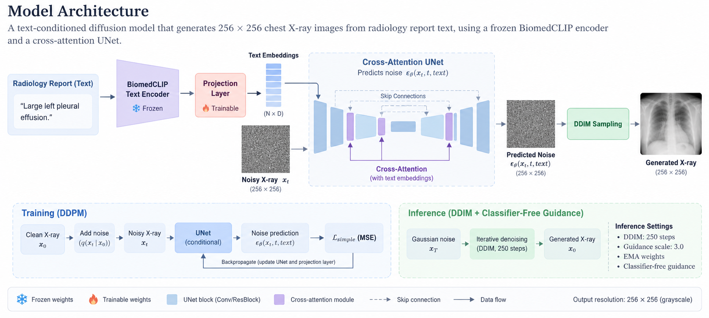
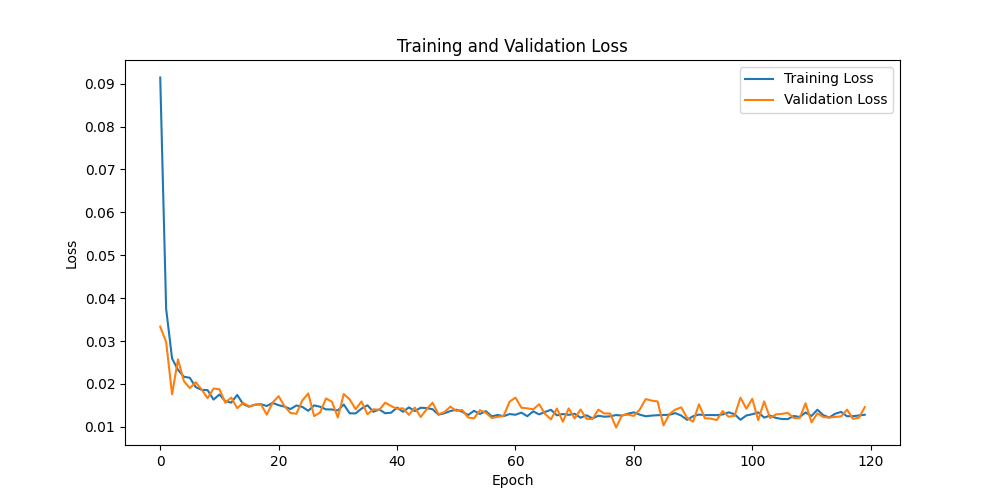
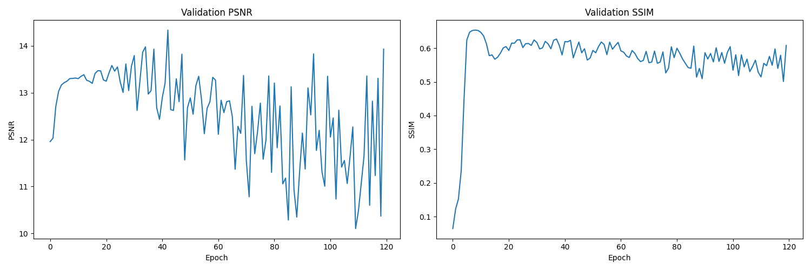
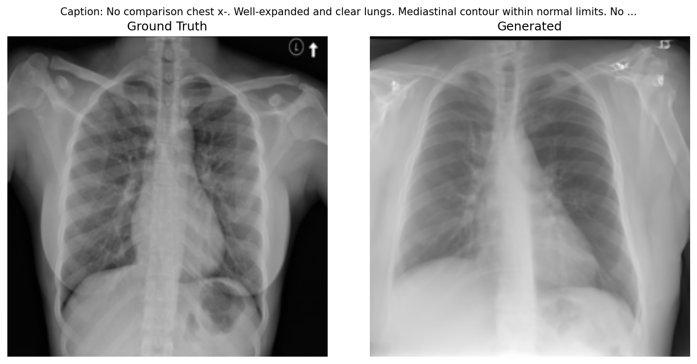

# Text-Conditional Diffusion for Chest X-Ray Synthesis

A text-conditioned diffusion model that generates 256×256 chest X-rays from radiology report text.

## Model Architecture



## Metrics

| Metric | Value |
|---|---:|
| FID | 32.99 |
| KID | 0.02542 ± 0.00413 |
| SSIM | 0.6081 |
| PSNR | 13.93 dB |

FID / KID: 2,000 samples conditioned on held-out report text vs. 3,851 real frontal X-rays,
2048-d Inception features, DDIM 250 steps, guidance scale 3.0, EMA weights.

Training and validation loss:



PSNR and SSIM per epoch, on a fixed 8-image validation batch:



## Ground Truth vs. Generated

Each generated image is conditioned on the report of its paired ground-truth image (epoch-120
validation batch).



## Reproduce

### 1. Environment

Requires an NVIDIA GPU (16 GB+ VRAM) with a CUDA 12.8-compatible driver, and Python 3.12.

```bash
curl -LsSf https://astral.sh/uv/install.sh | sh
export PATH="$HOME/.local/bin:$PATH"

uv venv .venv --python 3.12
source .venv/bin/activate
uv pip install -r requirements.txt
uv pip install --reinstall --index-url https://download.pytorch.org/whl/cu128 \
    torch torchvision torchaudio
```

`setup_env.sh` runs the same steps and also pre-downloads the BiomedCLIP and InceptionV3 weights
(edit `PROJ` at the top first).

### 2. Data

Download the Indiana University Chest X-ray Collection (IU-XRay) from
[Open-i](https://openi.nlm.nih.gov/faq): both the PNG images and the radiology reports.

```text
data/
└── IU-XRay/
    ├── NLMCXR_png/
    └── ecgen-radiology/
```

### 3. Train

Hyperparameters live in `Config` in `config.py`; the defaults are the reported run.

```bash
python train.py            # or, on SLURM: sbatch train.sbatch
```

Checkpoints go to `results/checkpoints/`. Rerunning `train.py` resumes from `model-latest.pt`;
`model-final.pt` is written when training completes.

```bash
tensorboard --logdir results/tensorboard
```

### 4. Evaluate (FID / KID)

```bash
python evaluate.py \
    --checkpoint results/checkpoints/model-final.pt \
    --n-samples 2000 \
    --features 2048 \
    --save-samples results/eval-samples
# or, on SLURM: sbatch eval.sbatch results/checkpoints/model-final.pt 2000
```

Results and the full run configuration are written to `results/eval_fid_kid.json`.
`--split-ratio` must match the value used for training.

### 5. Generate

```bash
python inference.py \
    --checkpoint results/checkpoints/model-final.pt \
    --caption "The heart is normal in size. The lungs are clear." \
    --output sample.png
```

`--n_steps` below 1000 uses DDIM (default 250); `--guidance_scale 1.0` disables classifier-free
guidance (default 3.0).

## Disclaimer

For research and education only. Generated images are not clinically validated and must not be
used for diagnosis.
